# Sweep capture checks and Measurement Review

HALS checks the electrical loopback during capture for audio-system faults, then checks the microphone recordings after the measurement set is complete. This guide shows how to inspect flagged points, re-capture them and apply your final capture choices.

## Error Checking During Measurement Capture

In Audio Setup, enable **Check golden loopback reference**. Keep the interface connections and gain settings unchanged during the measurement set.

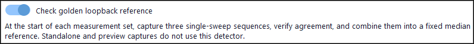

## 1 Let the loopback reference complete

Before the first measurement point, HALS records three loopback sweeps and checks that they are within tollerence. It combines them into a fixed **golden reference** for the rest of the run. If they are outside tollerence, preparation stops so you can investigate the audio system.

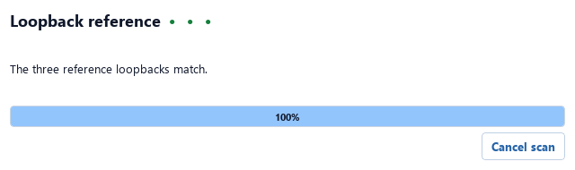

*Three green indicators confirm that the reference loopbacks match.*

During capture, each sweep's electrical loopback is compared with this reference. The check is sensitive to changes caused by driver dropouts, lost samples or interface instability. Microphone noise and acoustic problems are checked separately in Measurement Review.

## 2 Watch for rejected captures

If a capture fails, HALS marks that point orange and tries again according to the configured retry settings.

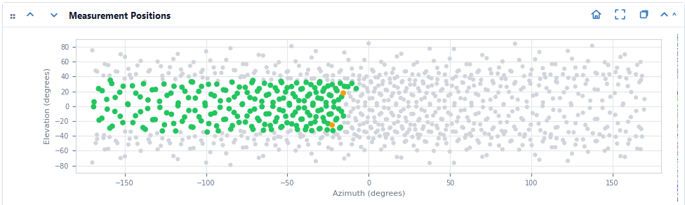

When a retry succeeds, the successful capture is used; the earlier rejection alone does not mean you need to re-capture that point manually

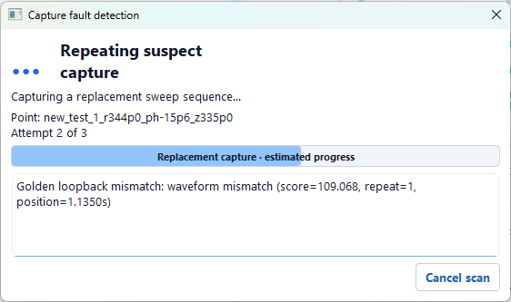

If failures continue, stop and investigate the audio connection, driver and interface before proceeding. The loopback check detects a mismatch; it does not identify the faulty component.

## Microphone Error Checking After Full Set Capture

The microphone checks described below run on the complete data set after the full capture process has finished.

In advanced sweep settings:

- **Driver settle time** adds silence before recording the first sweep. A longer interval allows a larger sample of pre-sweep captured noise for analysis. It also provides time for the audio driver to settle after the stream is opened. It is added once per acquisition, even when that acquisition contains several sweep repeats.

- **Post Silence** adds silence after the sweep. A longer interval allows a larger sample of post-sweep noise for analysis. It also provides a period in the recording to capture room decay and separates repeat sweeps. Audio-driver latency consumes part of this interval, so allow enough time for the room decay, driver latency and noise analysis.

Both settings add time to the measurement set. Each noise-analysis window needs at least 50 ms of usable audio after settling and guard intervals have been excluded, so setting the silence to 50 ms alone is not enough.

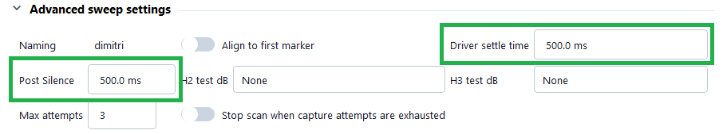

## 3 Inspect the completed measurement set

After a successful full capture, **Measurement Review** opens and scans the data set automatically. The dropdown menu provides filters for the displayed captures. **Needs review** shows suspect findings and checks that could not be completed. Click a filename to inspect its plots and read the detailed results below the list.

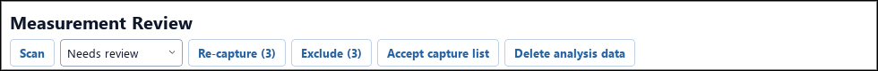

**Scan** - analyze the full data set.

**Filter Dropdown** - Selects which files are displayed: Needs review, Excluded or All recordings.

**Re-Capture** - After suspect captures have been selected, Re-capture (number of selections) commands HALS to repeat sweep capture at only those coordinates. Clicking this will activate the physical scanner.

**Exclude** - Marks the selected measurement point for exclusion from the data set. Accept capture list applies the exclusion by adding a `.blacklisted` suffix to its measurement file. This may be preferable to keeping a suspect or corrupt capture in the data set if it cannot be successfully re-captured.

**Accept Capture List** - After inspection and selection of new captures, this publishes the updated data set to the main measurements directory, substituting the chosen re-captures and applying any selected exclusions.

**Delete Analysis Data** - Deletes raw sweeps, full IRs with harmonic distortion terms, and supporting analysis files. Keeps the cropped linear IRs for HALS Studio use, along with capture choices and the review report. Use only when you have finished reviewing the captures and space is needed. Afterwards, full microphone/noise review and reprocessing of the raw sweeps are unavailable.

A flag is a reason to investigate, rather than proof that the measurement is unusable. Silent or clipped microphone recordings are also flagged.

## Results

### Pre-sweep noise

The green region checks microphone noise before the sweep against the rest of the set and up to 12 nearby positions. If it is flagged, look for disturbances before the sweep, remove the noise source and re-capture the point.

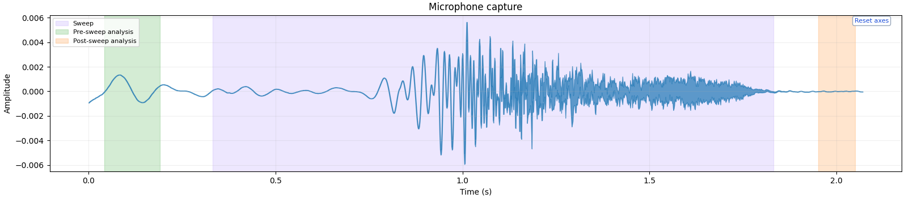

*The microphone capture contains a disturbance in the green analysis window.*

### Post-sweep noise

The orange region checks microphone noise after the final sweep against the rest of the set and up to 12 nearby positions. If it is flagged, look for disturbances after the sweep, remove the noise source and re-capture the point. Lingering room decay can also cause a flag, so consider whether more Post Silence is needed.

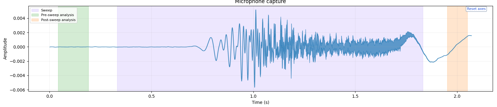

*A late disturbance extends into the orange analysis window.*

### LF response outside prediction

The low-frequency response from 40 to 320 Hz is compared with a prediction from the **12 nearest neighbours**. Low-frequency sound fields generally change gradually over distance, making prediction a useful comparison.

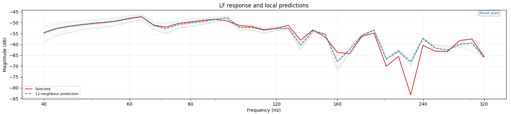

*The red measured response departs from the dashed neighbour prediction.*

Keep the room conditions consistent throughout the set. Opening or closing doors and windows can change the room's modal behaviour and LF response. A person standing beside the scanner, when they were absent for most of the capture, can also change the measured response. These changes can produce an LF flag.

Re-capture the point to check whether the difference repeats. A consistent difference can be a real acoustic feature, so an LF flag alone does not establish that the capture is faulty.

## 4 Re-capture selected points

Tick the **Select** boxes beside the points you want to repeat, then press **Re-capture**. 

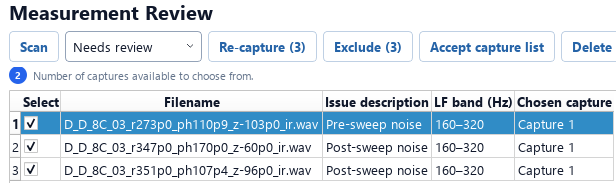

*Three original suspect points selected for another capture.*

Machine Control and Live Capture open, and the scanner visits only the selected coordinates. When the batch ends, Review returns and checks the new captures.

## 5 Compare and choose captures

Click the capture buttons above the plots (top left) to inspect each attempt. You can re-capture a point again and build up a choice of alternatives.

The blue outline around a capture button identifies the one you are viewing; the **chosen** label identifies the one selected for use.

Press **Choose this capture** (top right) for the attempt you want to use. This must be done for each re-captured point in the file list. 

Viewing a capture does not choose it. The list's **Issue description** relates to the chosen capture, which may differ from the one you are viewing.

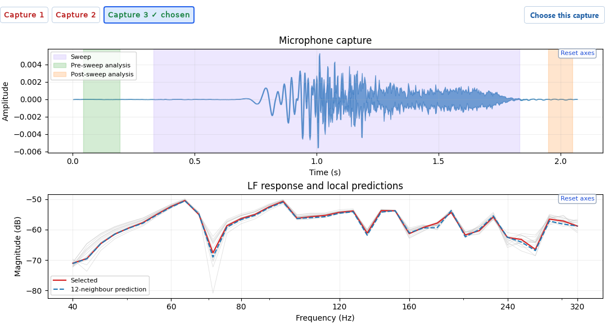

*Capture 3 passes the checks in this example.*

| Capture button | Meaning |
| --- | --- |
| Green | All automatic checks passed. |
| Red | At least one check flagged the capture. |
| Orange | A check could not be completed, or capture data is unavailable. Read the details below the list. |

A detailed description of the analysis results can be read under the file list.

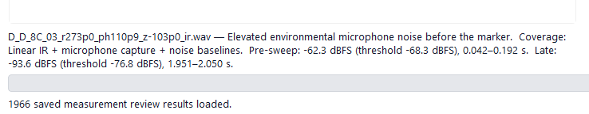

If a new capture remains red, inspect the reason and compare the alternatives. You can repeat the point again, keep a flagged capture after investigating it, or exclude the point.

## 6 Accept the capture list

When satisfied with your choices, press **Accept capture list**. Choosing a capture alone does not replace the active measurement file.

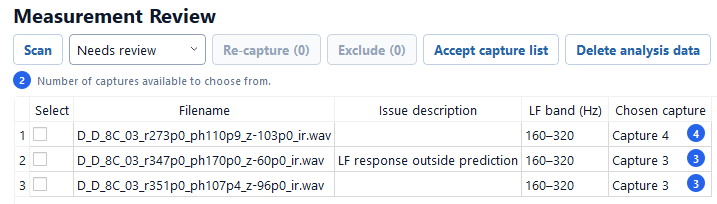

*The chosen captures are listed for each point. The middle point still has an LF prediction flag.*

The **blue badge with a number** in the list shows how many complete captures are available for that point.

Acceptance copies the chosen replacements into the main **measurement_set** directory and applies exclusions. Original and alternative captures remain under **review_attempts** for future reference. HALS warns before accepting captures with failed or incomplete checks.

## Golden Loopback - How does it work

The check uses a **null test**: it aligns the captured loopback with the golden reference and subtracts one from the other. A close match cancels almost completely, leaving a very low residual. Changes in level, phase or waveform shape leave a larger residual.

The main detection threshold is approximately **-40 dB**, or a residual of **1%** relative to the reference. To illustrate:

- **Gain mismatch:** a level increase of **~0.1 dB**, with everything else identical, produces approximately a -40 dB residual.
- **Timing mismatch:** for equal-level 1 kHz sine waves, a timing error of **~1.6 microseconds** produces approximately a -40 dB residual. Fixed driver latency is removed by marker alignment, so it does not count as error.

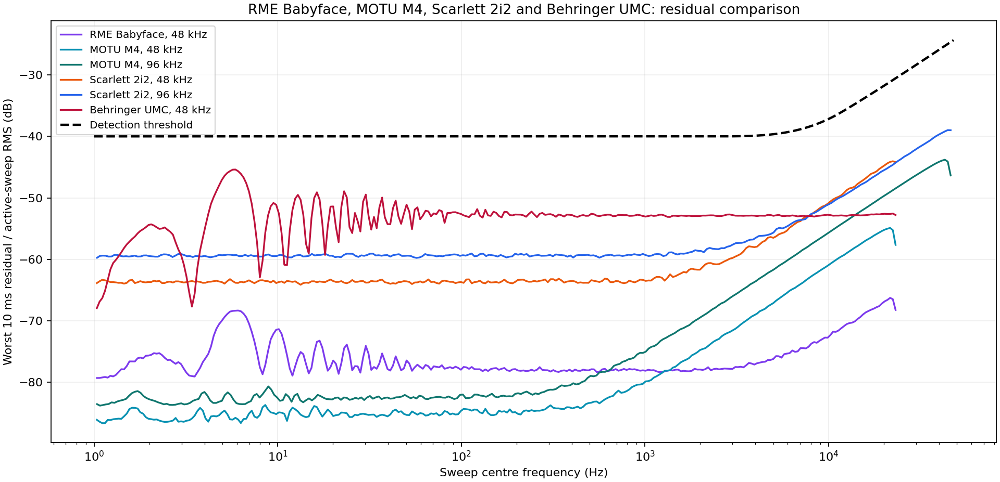

*Measured interface residuals against the dashed detection threshold. Lower curves mean closer repeatability.*

The threshold rises at high frequencies because circuit noise and small timing variations, including clock jitter, cause larger waveform differences there. This allowance helps accommodate normal interface variation while retaining a sensitive check for capture faults.
