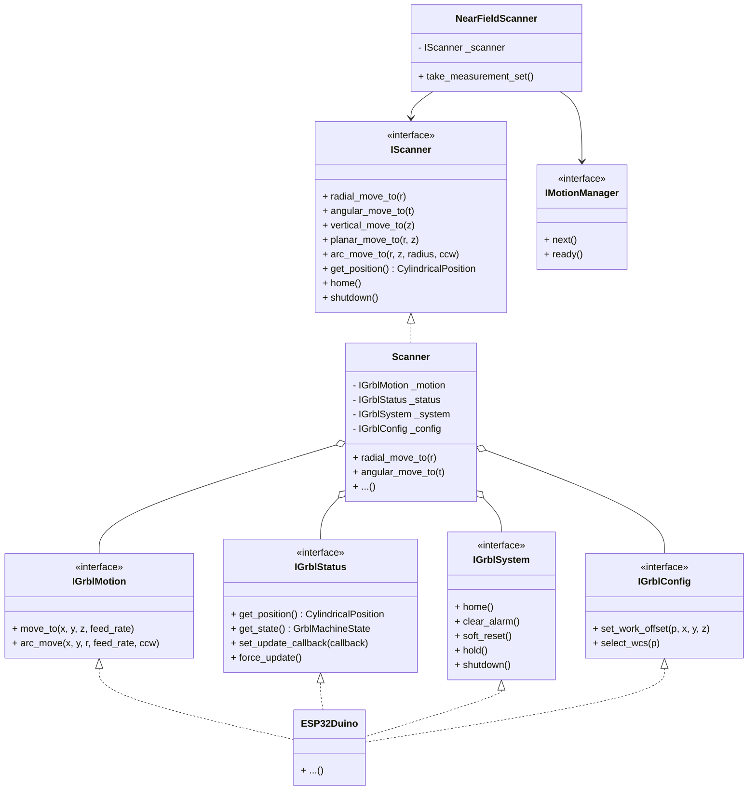
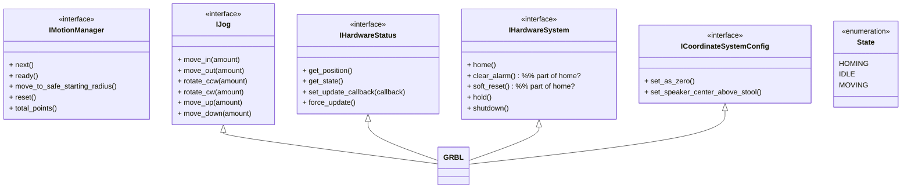

Er lijken een aantal states te zijn
- Jogging
- Measuring

Misschien zijn er dan ook wel 2 interfaces:
- IJogging
- IMeasuring

en misschien een aparte voor wat kleine (audio) testjes

NFS heeft nu een motion manager. Misschien heeft ie wel een measurement manager/controller nodig

De motionmanager heeft nu een scanner. Maar de scanner heeft nu zowel cylindrische bewegingsfuncties (ook voor jogging)
Daarnaast heeft ie ook nog spherische functies. Maar die horen daar eigenlijk niet. Ik zou graag een IScanner oid willen hebben
en die zou gewoon een ga naar positie functie moeten hebben; onafhankelijk van hoe het daarachter wordt opgelost.
Er zou een high level grbl class kunnen zijn. Die allerlei bewwegingsfuncties die grbl ondersteund onder een fatsoenlijke naam
beschikbaar stelt.

Analysis of Splitting Motion Planning and Point Iteration
Your observation is spot on: the current IMotionManager implementations (e.g., CylindricalMeasurementMotionManager, SphericalMeasurementMotionManager) combine two distinct responsibilities:
1.
Motion Execution & Trajectory Safety: Safe path planning, collision avoidance (no-fly zone boundary checks/retraction), and hardware motion commands via Scanner.
2.
Scan Iteration / Point Traversal: Holding the MeasurementPoints collection, calling .next(), .ready(), .reset(), enforcing skip/abort policies, and managing point progress.
Introducing a higher-level orchestrator or refactoring this hierarchy offers substantial architectural and practical benefits, as well as a few trade-offs to keep in mind.
Key Benefits of Splitting
1.
Single Responsibility Principle (SRP):
◦
MotionManager / TrajectoryPlanner: Focuses purely on how to get the scanner safely from point $A$ to point $B$ (e.g., move_safely_to(target_pos), handling retract radii, arc moves, collision evasion).
◦
MeasurementSetManager / ScanOrchestrator: Focuses on looping through MeasurementPoints, querying the MotionManager to execute the move, coordinating measurement captures with Audio, and reporting progress/pause/stop states.
2.
Reusability and Composability:
◦
Different motion strategies (e.g., cylindrical safe moves, spherical arc moves, rapid continuous moves) can be reused across different measurement point generators without coupling them directly to MeasurementPoints iterators.
◦
It becomes trivial to support different scanning modes (e.g., point-by-point stop-and-measure vs. continuous on-the-fly scanning) using the same motion planner.
3.
Cleaner Division with NearFieldScanner:
◦
Currently, NearFieldScanner.take_measurement_set() acts as a partial orchestrator (managing audio capture, threading events, position CSV logging) while driving self._measurement_motion_manager.next().
◦
Introducing a dedicated MeasurementSetManager or promoting NearFieldScanner's scan loop to coordinate a clean MotionManager + MeasurementPoints separation cleans up NearFieldScanner and eliminates duplicate iterator logic across different motion manager classes.
4.
Testability:
◦
Motion safety paths and move sequences can be unit tested with simple point-to-point target calls (e.g., motion_manager.move_to(pos)) without having to instantiate or mock a full MeasurementPoints iterator sequence.
◦
Point generation, filtering, and iteration logic can be tested independently of scanner hardware commands.
Suggested Architectural Approaches
Approach A: Dedicated MeasurementSetManager Layer
Introduce an orchestration class that composes MeasurementPoints, MotionManager, and optionally IAudio:
┌──────────────────────────────────────────┐
│          MeasurementSetManager           │
│  - coordinates iteration & flow control  │
└──────┬────────────────────────────┬──────┘
       │ delegates move             │ iterates
       ▼                            ▼
┌──────────────────┐       ┌─────────────────┐
│  MotionManager   │       │MeasurementPoints│
│  - safe paths    │       │- point sequence │
│  - no-fly zone   │       └─────────────────┘
│  - Scanner move  │
└──────────────────┘
•
MotionManager Interface:
◦
move_to(position: CylindricalPosition) -> None
◦
move_to_safe_starting_position() -> None
◦
is_point_safe(position: CylindricalPosition) -> bool
•
MeasurementSetManager:
◦
Holds MeasurementPoints and MotionManager.
◦
Exposes next(), has_next(), total_points(), progress calculation, and pause/abort policies.
Approach B: Refactor NearFieldScanner Directly
If you want to avoid introducing too many new abstraction layers:
•
Simplify MotionManager to be solely a safety & motion executor: move_to(position).
•
Pass MeasurementPoints directly into NearFieldScanner.take_measurement_set(points=...) (or store MeasurementPoints at the scan session level).
•
NearFieldScanner directly loops over MeasurementPoints and calls motion_manager.move_to(point).
Conclusion & Recommendation
Yes, splitting these responsibilities is a recommended improvement.
•
It eliminates boilerplate code across motion manager implementations.
•
It decouples geometry/motion algorithms from collection/iteration logic.
•
It makes the motion controllers simpler, safer, and easier to verify with unit tests.

