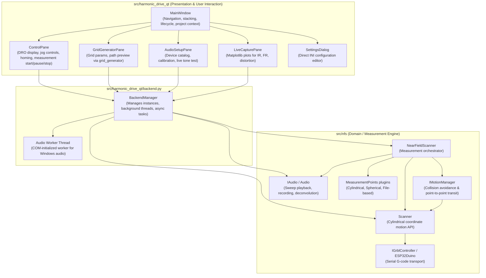

# Harmonic Drive Qt Architecture & NFS Interaction

This document provides developer documentation on how `src/harmonic_drive_qt` operates, how it communicates and integrates with `src/nfs`, and an analysis of misplaced responsibilities, architectural debt, and leaky abstractions in the codebase.

---

## 1. High-Level Architecture & Interaction Flow

`src/harmonic_drive_qt` is a native desktop application built with PySide6 / PyQt6. It acts as the GUI frontend to control the motion hardware (via GRBL), configure and calibrate audio hardware, plan and generate measurement grids, and display impulse responses / frequency curves.

### Component Relationship



---

## 2. Interaction Details

### 2.1 Bridge Pattern via `BackendManager`
- `BackendManager` (`src/harmonic_drive_qt/backend.py`) serves as the central bridge between Qt's event loop and `src/nfs`.
- **Async Execution**: `BackendManager` uses a `QThreadPool` worker pattern (`Worker(QRunnable)`) to ensure hardware queries and long-running scans do not block the Qt GUI thread.
- **Audio Worker Thread**: Windows COM apartment initialization (`CoInitializeEx`) is handled via a dedicated `_audio_worker` thread to prevent COM concurrency deadlocks during audio measurement and device probing.

### 2.2 Control and Data Flows
1. **DRO & Coordinate Polling**:
   - `ControlPane` runs a 250ms `QTimer` invoking `BackendManager.get_position()`.
   - `BackendManager` delegates to `Scanner.get_position()` and `Scanner.get_status()`, returning `(wcs, mcs)` coordinates and controller machine status (e.g., `Idle`, `Run`, `Alarm`).
2. **Measurement Grid Execution**:
   - `ControlPane` triggers `BackendManager.run_measurement_grid()`.
   - `BackendManager` runs `NearFieldScanner.run()` inside a worker thread.
   - `NearFieldScanner` steps through `IMotionManager`, moves `Scanner`, triggers `IAudio.take_measurement()`, and invokes progress callbacks that emit Qt signals to update the UI progress bar.
3. **Live Capture & Visualization**:
   - Upon measurement completion, `LiveCapturePane` reads generated `.mat` or CSV files and plots impulse responses, frequency responses, and harmonics using `matplotlib`.

---

## 3. Analysis of Misplaced Responsibilities & Code Smells

Several responsibilities are currently located in inappropriate layers or duplicated across the codebase:

### 3.1 Homing and Motion State Maintained in Ephemeral GUI Widgets
* **Location**: `src/harmonic_drive_qt/control_pane.py` (`self.home_ok`) and `src/harmonic_drive_qt/main_window.py` (`_rebuild_control_pane()`).
* **Issue**:
  - `ControlPane` stores homing state as a widget instance attribute (`self.home_ok = False`).
  - When configuration settings are changed in `SettingsDialog`, `MainWindow.on_settings_applied()` discards and reconstructs the `ControlPane` widget (`_rebuild_control_pane()`).
  - Rebuilding the widget resets `self.home_ok` to `False` (turning buttons yellow/orange) even when the physical machine is still homed and the connection to GRBL is intact.
* **Proper Responsibility**:
  - Homing and machine coordinate validity are motion hardware states.
  - The authoritative state belongs in `Scanner` or `BackendManager` (queried from GRBL status), while the GUI should purely observe this state.

### 3.2 Scattered Direct `config.ini` Mutation
* **Location**: `SettingsDialog`, `AudioSetupPane`, `GridGeneratorPane`, and `MainWindow`.
* **Issue**:
  - Multiple GUI widgets read from and write directly to `config.ini` on disk using `configparser.ConfigParser` (e.g. `save_config_values()` in `audio_setup_pane.py`).
  - Whenever a pane alters configuration, other components must be manually reloaded or rebuilt (`backend.load()`, `_rebuild_control_pane()`, `_rebuild_audio_pane()`).
* **Proper Responsibility**:
  - Configuration management should be encapsulated in a single domain configuration service (`ConfigManager`).
  - Panes should request changes through the configuration service, which notifies listeners via events/signals rather than widgets directly modifying files.

### 3.3 Duplication of Path Planning & Geometry Math (`grid_generator` vs. `src/nfs`)
* **Location**: `grid_generator/path_plan.py` vs. `src/nfs/motion_manager.py`.
* **Issue**:
  - `src/nfs/motion_manager.py` implements collision models, no-fly zones, and safe transition moves for runtime execution.
  - `grid_generator/path_plan.py` and `grid_generator/grid_gen.py` duplicate transition calculations, safe radius checks, and waypoint ordering for visual preview in `GridGeneratorPane`.
  - Changes to collision geometry in `nfs` risk desynchronizing the visual preview in the GUI.
* **Proper Responsibility**:
  - All path planning, waypoint ordering, and collision validation should reside in `src/nfs` (e.g. `nfs.motion_manager` or a shared `nfs.path_planning` module).
  - `GridGeneratorPane` should consume the exact planning engine used during execution.

### 3.4 Hardware Protocol Sequences Embedded in UI Logic
* **Location**: `src/harmonic_drive_qt/control_pane.py` (`_rehome_blocking`).
* **Issue**:
  - Protocol sequences, recovery steps, and arbitrary sleep timings (e.g. `softreset` -> `sleep(1)` -> `clear_alarm` -> `sleep(1)` -> `home`) are hardcoded directly into the UI pane:
    ```python
    def _rehome_blocking(self) -> None:
        self.backend.scanner_command("softreset")
        time.sleep(1)
        self.backend.scanner_command("clear_alarm")
        time.sleep(1)
        self.backend.scanner_command("home")
    ```
* **Proper Responsibility**:
  - Controller error recovery and homing sequences belong in `Scanner` or `IGrblController`.
  - The UI should simply call `backend.rehome()` without managing timing delays or low-level controller commands.

### 3.5 File Export & Data Formatting Inside UI Panes
* **Location**: `GridGeneratorPane._save_grid()` and `ControlPane._save_measurement_project_snapshot()`.
* **Issue**:
  - Formatting CSV point files, generating header comments, and creating project directory snapshots are handled directly in Qt widget methods using low-level file I/O and `shutil`.
* **Proper Responsibility**:
  - File format serialization and session persistence should be handled by `nfs.measurement_points` and `nfs.session`, enabling headless CLI scripts and GUI workflows to generate identical formats consistently.

---

## 4. Architectural Recommendations

1. **Promote Hardware State to Backend**:
   Move `is_homed`, `is_connected`, and alarm state out of `ControlPane` and into `BackendManager` / `Scanner`.
2. **Centralize Configuration**:
   Create a unified configuration layer that manages disk persistence and emits reactive change signals across the application.
3. **Consolidate Path Planning into `src/nfs`**:
   Remove duplicated geometry algorithms from `grid_generator` and make `src/nfs` the sole authority for motion trajectories.
4. **Encapsulate Hardware Recovery**:
   Move command sequences and timing delays from UI blocking methods into `Scanner` / `GRBLController`.
